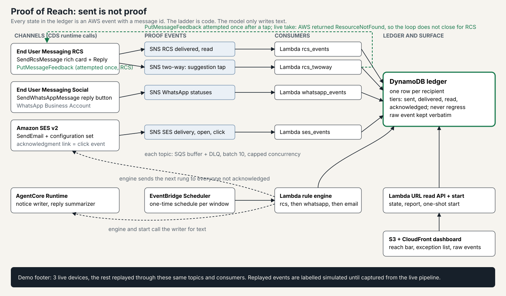

# Proof of Reach

**Sent is not proof.** Proof of Reach pursues a mandatory notice (a product recall, a breach
notification, a fee notice) across RCS, WhatsApp and email until every person has provably
acknowledged it, and shows exactly who still does not know.

Built for the AWS Communication Developer Services Agentic AI Partner Hackathon.
Three CDS services are called at runtime: AWS End User Messaging (RCS), AWS End User Messaging
Social (WhatsApp) and Amazon SES. The agent runs on Amazon Bedrock AgentCore Runtime.



## What it does

1. The officer presses **Start notice**. The agent on AgentCore Runtime writes a one-thumb notice
   per audience (consumer, dealer) and per channel. A deterministic validator checks that product,
   hazard, action and contact are present and in order; text that fails is replaced by stored text
   and marked "default text".
2. The rule engine sends rung 1 (RCS rich card with a Reply suggestion). Delivery, read and tap
   events arrive on SNS and are written to a DynamoDB ledger with the raw event and message id.
3. After the window, everyone **not acknowledged** gets the next rung (WhatsApp reply button, then
   email with an acknowledgment link). An acknowledged recipient never receives anything again.
4. After the last window, anyone who was never delivered anything is marked **unreachable** with a
   reason. Someone delivered or read but not acknowledged stays in that tier.
5. The dashboard shows one stacked bar (acknowledged, read only, delivered only, sent only,
   unreachable), a per channel breakdown, the raw AWS event next to each live device, and a report
   that ends with "N people: unreachable, letter needed".

### The three proof tiers

| Tier | Source event | Counts as proof |
|---|---|---|
| delivered | `RCS_DELIVERED`, WhatsApp `delivered`, SES `Delivery` | no |
| read | `RCS_READ`, WhatsApp `read`, SES `Open` | no: read receipts can be switched off, email opens are pixel based |
| acknowledged | RCS Reply tap (the "Read the notice" link tap counts as read), WhatsApp button reply, SES `Click` on the acknowledgment link | yes |

A tier never regresses, a duplicate event changes nothing, an event flagged as a bot (`isBotEvent`
Likely) is stored but never counted, and the ledger refuses to write an acknowledgment without a
provider event id and the raw payload.

## Where each CDS runtime call lives

| Service | API call | File and line |
|---|---|---|
| End User Messaging RCS | `SendRcsMessage` | `src/senders/rcs.py:29` |
| End User Messaging RCS | `PutMessageFeedback` | `src/common/feedback.py:49` |
| End User Messaging Social | `SendWhatsAppMessage` | `src/senders/whatsapp.py:48` |
| Amazon SES v2 | `SendEmail` | `src/senders/email.py:24` |
| AgentCore Runtime | `InvokeAgentRuntime` | `src/agent/client.py` (`invoke_runtime`) |
| AgentCore Runtime | the agent itself | `agent_runtime/main.py` |

`tests/test_readme.py` fails if these line numbers drift.

## Run it

Prerequisites: an AWS account with Bedrock model access, AWS CLI, AWS SAM CLI, Python 3.12.

```bash
scripts/deploy.sh                       # one command: package the agent, deploy the stack, publish the dashboard
python seed/seed.py --stack proof-of-reach          # seed 2,000 recipients (add --reset to start over)
python seed/replay.py --stack proof-of-reach        # run after phone A is tapped (see the runbook below)
```

Open the dashboard URL that `deploy.sh` prints and press **Start notice**. Wait until the dashboard shows
"100 % sent", tap the notice on phone A, then start `seed/replay.py`.

Live devices: copy `seed/live_devices.example.json` to `seed/live_devices.json` and fill in your test
phones and mailbox before seeding. Without that file every recipient is replayed and the footer says
"0 live devices".

### Identities you create once (the stack cannot do these for you)

| What | How | Then |
|---|---|---|
| RCS testing agent and test devices | End User Messaging console, RCS agents, testing agent; each phone accepts the tester invitation | `RCS_AGENT_ID=rcs-... scripts/deploy.sh`, then `python scripts/wire_channels.py --rcs-agent rcs-...` |
| WhatsApp number | End User Messaging Social, embedded signup with a fresh number | `WHATSAPP_PHONE_NUMBER_ID=... scripts/deploy.sh`, then `python scripts/wire_channels.py --waba <id>` |
| SES sender and demo mailbox | verify both addresses (SES sandbox) | `SES_SENDER=... scripts/deploy.sh` |

`scripts/deploy.sh` keeps the identity values the stack already has when you do not set the variable, so adding the WhatsApp id later never blanks the RCS id. Set a variable to `-` to clear it on purpose.

Until an identity exists, the matching live send fails with a recorded reason (visible in the
exception list) and the ladder continues; it never crashes the notice.

## Public surface

The dashboard and its read API need no login (the dashboard is the monitoring view of the automation).
`POST /start` requires the `x-start-token` header and the API's CORS allows only the dashboard origin.
The token is not a secret (the dashboard config carries it); it stops cross-site and drive-by starts.
A notice can be started once; `python seed/seed.py --reset` re-arms it. The API never returns phone
numbers or mailboxes: raw provider events are filtered through an allowlist (`src/api/redact.py`).

## What is live and what is replayed

The demo uses a small number of real devices. The other recipients are replayed: `seed/replay.py`
publishes provider events, in the real payload shapes, to the same SNS topics, so the same SQS queues,
consumers and ledger code process them. Nothing writes to the ledger directly.

- The dashboard footer always states the split, for example "2,000 recipients · 3 live devices ·
  1,997 replayed from simulated events".
- The replay corpus is `simulated` (payload shapes from the AWS documentation, planned outcomes that
  match the demo report). The footer says "recorded events" only when the corpus provenance is
  `recorded`.
- Replayed recipients get no CDS call; their send is recorded with a `replay-` message id.

## Tests

```bash
python3.12 -m venv .venv && . .venv/bin/activate && pip install -r requirements-dev.txt
PYTHONPATH=src python -m pytest tests
```

The suite covers the ledger rules, every consumer with documented payloads, request shapes
validated against the SDK models, the ladder, the report arithmetic, and an end to end replay that
must reproduce the planned outcomes.

## Limits

- No claim is made about what counts as "notified" under any recall law. The ledger records what
  the providers reported.
- WhatsApp inbound `button_reply` is handled according to Meta's webhook format; AWS does not
  document it, so it still has to be confirmed on a live number (`scripts/dump_events.py --channel whatsapp`).
- WhatsApp free-form interactive messages need an open 24 hour customer window; outside it set
  `WHATSAPP_TEMPLATE_NAME` to an approved template with one quick reply button.
- A new AWS account can have a Lambda limit of 10 concurrent executions. The consumers are
  buffered through SQS for that reason; request a higher quota for production volumes.
- `PutMessageFeedback` must happen within one hour of the send; later taps are recorded and the call
  is skipped.

## AI disclosure

This project was built with AI coding assistants. The repository was created for this hackathon and
contains no earlier code beyond open source libraries.

License: MIT
